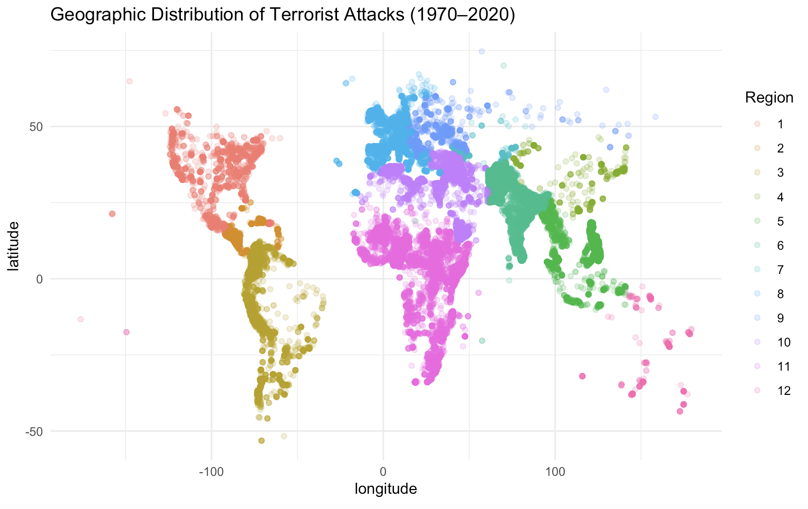
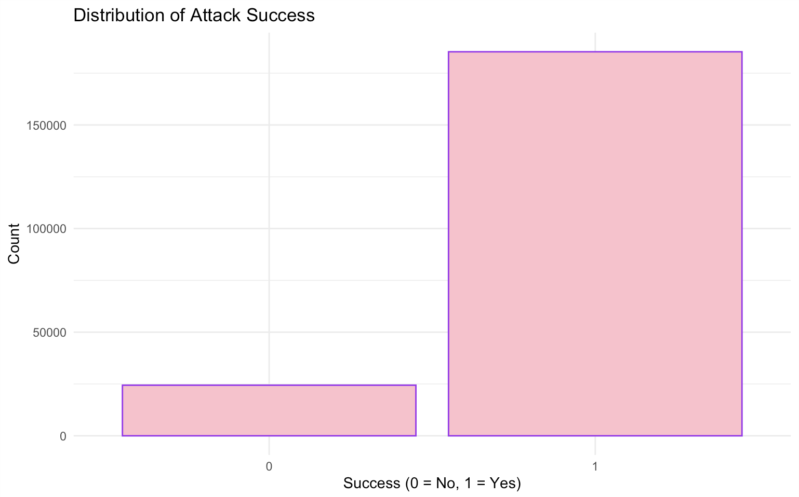
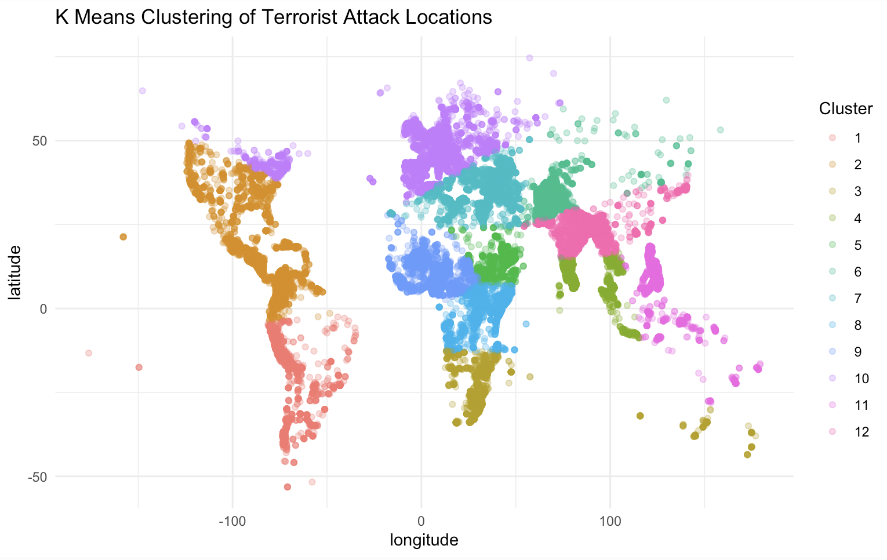

# Global Terrorism Data Analysis
### Machine Learning, Statistical Modeling & Geographic Patterns in R

An exploratory and predictive analysis of **209,706 historical terrorism incidents (1970–2020)** using statistical learning, classification algorithms, and geographic clustering.

**[View Full Analysis Report](https://katelynmccullough.github.io/global-terrorism-data-analysis/)** | **[R Markdown Source](Project/Report_McCullough.Rmd)** | **[Project Presentation](Presentation/Presentation_McCullough.pptx)**

**Technologies:** R · Tidyverse · ggplot2 · caret · Random Forest · XGBoost · Logistic Regression · K-Means Clustering

---

## Project Overview

The Global Terrorism Database (GTD) contains historical information on terrorist incidents worldwide, including geographic locations, attack characteristics, and recorded outcomes.

This project examines geographic patterns in terrorist activity and evaluates how machine learning algorithms perform when applied to large, imbalanced datasets.

Using **209,706 observations spanning 1970–2020**, I explored geographic distributions, compared classification methods, and investigated how class imbalance affects predictive performance.

**Key takeaway:** High classification accuracy does not necessarily indicate a useful model, especially when one outcome occurs much more frequently than another.

### Research Questions

1. Can machine learning models classify recorded attack outcomes using historical event characteristics?
2. How does class imbalance influence model performance?
3. How do different classification algorithms compare?
4. What geographic patterns emerge from unsupervised clustering?

---

## Project Visualizations

### 1. Geographic Distribution of Terrorist Attacks



This visualization maps historical incidents using latitude and longitude, with observations colored by geographic region.

The distribution reveals concentrations of recorded incidents across particular geographic areas rather than an even global distribution.

### 2. Distribution of Attack Success



The majority of incidents in the dataset are classified as successful.

This imbalance creates a significant modeling challenge: a classifier can achieve relatively high accuracy by predicting the majority class while failing to identify unsuccessful attacks.

### 3. K-Means Geographic Clustering



K-Means clustering was applied to geographic coordinates to identify spatial groupings of historical incidents.

The analysis demonstrates how unsupervised learning can identify geographic patterns without predefined cluster labels.

**[Explore All Visualizations in the Full Report](https://katelynmccullough.github.io/global-terrorism-data-analysis/)**

---

## Dataset

**Source:** [Global Terrorism Database (GTD)](https://www.start.umd.edu/gtd)

| Characteristic | Description |
|---|---|
| Observations | 209,706 |
| Original variables | 135 |
| Analysis variables | 45 |
| Time period | 1970–2020 |
| Geographic coverage | Worldwide |
| Classification target | Recorded attack success |

The analysis incorporates geographic coordinates, regional classifications, attack characteristics, and recorded outcomes.

### Data Preparation

The original dataset was reduced from 135 to 45 variables by selecting numeric variables with an absolute correlation greater than 0.05 with latitude or longitude.

Additional preprocessing included:

- Identifying missing and incomplete observations
- Handling placeholder values such as `-99`
- Selecting predictors for classification models
- Preparing training and testing datasets
- Evaluating the distribution of successful and unsuccessful attacks

**Data availability:** The raw GTD dataset is not included in this public repository. Researchers can obtain the data through the [official GTD website](https://www.start.umd.edu/gtd), subject to its access and usage requirements.

---

## Methodology

The project combines exploratory data analysis, supervised machine learning, and unsupervised geographic clustering.

### 1. Exploratory Data Analysis

Exploratory analysis was performed using R, Tidyverse, ggplot2, and ggcorrplot.

The analysis included:

- Summary statistics and missing-value patterns
- Correlation analysis and variable selection
- Geographic distributions of recorded incidents
- Regional differences in incident frequency
- Distributions of successful and unsuccessful attacks

These exploratory steps helped identify patterns and challenges relevant to subsequent modeling.

### 2. Supervised Machine Learning

Four classification approaches were evaluated.

**Logistic Regression**

An interpretable baseline model for binary classification.

**Random Forest**

An ensemble learning method that combines multiple decision trees to classify attack outcomes.

**Balanced Random Forest**

A Random Forest approach incorporating up-sampling during training to improve the representation of the minority class.

**XGBoost**

A gradient-boosted decision-tree model used as an additional ensemble learning comparison.

The analysis used a 70/30 training-test split and evaluated predictions using confusion matrices and classification metrics.

### 3. Unsupervised Learning

**K-Means Clustering** was applied to geographic coordinates to explore spatial groupings of historical incidents.

The analysis included:

- Geographic cluster visualizations
- An elbow plot to examine cluster selection
- Comparisons between generated clusters and predefined geographic regions

---

## Results and Findings

### Classification Performance

| Model | Reported Accuracy | Minority-Class Recall |
|---|---:|---:|
| Logistic Regression | 88.35% | 0.0% |
| Random Forest | 89.14% | 10.5% |
| Balanced Random Forest | 82.95% | 42.1% |
| XGBoost | 30.18% | Requires verification |

*These results are from the original academic report and have not been independently revalidated. The XGBoost evaluation contains an apparent predicted-label inversion, so its reported accuracy should not be used to rank the algorithms without correction and re-evaluation.*

### Key Finding 1: Accuracy Can Be Misleading

The logistic regression model achieved **88.35% accuracy**, matching the majority-class baseline.

However, its confusion matrix showed that it predicted only successful attacks, failing to identify any unsuccessful attacks.

This demonstrated why overall accuracy alone is insufficient for evaluating models trained on imbalanced datasets.

### Key Finding 2: Balancing Improves Minority-Class Detection

The original Random Forest model achieved **89.14% accuracy** but identified only approximately **10.5%** of unsuccessful attacks.

After incorporating up-sampling, the balanced Random Forest achieved:

- **82.95% overall accuracy**
- **42.1% minority-class recall**
- **65.2% balanced accuracy**

Although overall accuracy decreased, the balanced model substantially improved its ability to identify the minority class.

This illustrates the trade-off between maximizing overall accuracy and detecting less frequent outcomes.

### Key Finding 3: Model Complexity Does Not Guarantee Better Performance

The analysis compared multiple classification algorithms with different modeling assumptions and approaches to class imbalance.

The results demonstrated that more complex algorithms do not automatically produce more useful predictions.

Model performance must be interpreted in relation to the problem, class distribution, and evaluation metrics.

### Key Finding 4: Geographic Clustering Reveals Spatial Patterns

K-Means clustering identified geographic groupings of recorded incidents that partially aligned with established regions.

These results illustrate how unsupervised learning can organize observations using spatial information.

However, mathematical clusters do not necessarily correspond to meaningful political or geographic boundaries.

---

## Project Structure

```text
global-terrorism-data-analysis/
│
├── README.md
│
├── images/
│   ├── geographic-distribution.png
│   ├── attack-success.png
│   └── kmeans-clustering.png
│
├── Project/
│   ├── Report_McCullough.Rmd
│   └── Report_McCullough.html
│
├── docs/
│   └── index.html
│
├── Presentation/
│   └── Presentation_McCullough.pptx
│
└── Proposal/
    └── Proposal_Idea.pdf
```

### Project Files

| Resource | Description |
|---|---|
| [Full Analysis Report](https://katelynmccullough.github.io/global-terrorism-data-analysis/) | Published report containing analysis, code, and visualizations |
| [R Markdown Source](Project/Report_McCullough.Rmd) | Statistical analysis and machine learning implementation |
| [HTML Report](Project/Report_McCullough.html) | Original rendered report |
| [Project Presentation](Presentation/Presentation_McCullough.pptx) | Presentation summarizing the project |
| [Original Proposal](Proposal/Proposal_Idea.pdf) | Initial research proposal |

---

## Tools and Technologies

| Technology | Application |
|---|---|
| R | Data processing, statistical analysis, and modeling |
| Tidyverse / dplyr | Data manipulation and exploration |
| ggplot2 / ggcorrplot | Statistical and geographic visualization |
| caret | Classification training and evaluation |
| randomForest | Ensemble classification |
| XGBoost | Gradient-boosted classification |
| glmnet | Regularized regression tools |
| R Markdown | Reproducible analytical reporting |

---

## Challenges and Lessons Learned

### Class Imbalance

The dataset contained substantially more successful attacks than unsuccessful attacks.

This demonstrated why classification accuracy should be evaluated alongside minority-class recall, balanced accuracy, and confusion matrices.

### Missing Data

Incomplete observations and placeholder values required careful preprocessing.

Handling missing information was important for retaining usable observations while preparing datasets for modeling.

### Computational Requirements

Working with more than 200,000 observations introduced computational challenges when training ensemble models.

Saving trained models helped avoid unnecessary repeated computation.

### Interpretability

Geographic clustering and correlation analysis required distinguishing observed statistical patterns from causal relationships or meaningful real-world boundaries.

### Technical Skills Developed

This project strengthened my experience in:

- Exploratory data analysis
- Statistical learning and machine learning
- Data preprocessing and feature selection
- Model training and evaluation
- Class imbalance and resampling
- Geographic data visualization
- Communicating analytical findings

---

## Limitations

This analysis is exploratory and should not be interpreted as a system for predicting specific future incidents.

The GTD reflects historical reporting and may contain incomplete records, reporting biases, and measurement limitations.

Geographic associations do not establish causal relationships, and classification performance depends on the available predictors, preprocessing decisions, and evaluation procedures.

The reported model results reflect the original academic analysis. Certain evaluation decisions, particularly the XGBoost predicted-label conversion, require further validation.

---

## About the Author

**Katelyn McCullough**

B.S. Data Science | Florida Polytechnic University

Interested in data science, machine learning, data engineering, and applying statistical methods to complex real-world problems.

- **Portfolio:** [Katelyn Codes](https://katelynmccullough.github.io/katelyncodes/)
- **GitHub:** [katelynmccullough](https://github.com/katelynmccullough)
- **LinkedIn:** [Katelyn McCullough](https://www.linkedin.com/in/katelynmccullough09/)

---

*Originally developed as an academic statistical learning project and presented as part of my data science portfolio.*

**Data Source:** National Consortium for the Study of Terrorism and Responses to Terrorism (START), University of Maryland. Global Terrorism Database.
